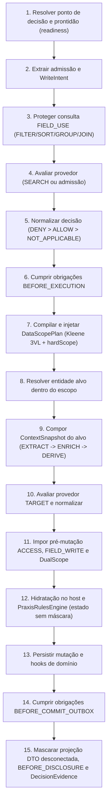
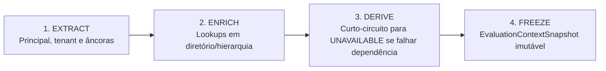

# Praxis Authz Enforcement Core

[](https://central.sonatype.com/artifact/io.github.codexrodrigues/praxis-authz-enforcement-core)


[](LICENSE)

Runtime determinístico e *fail-closed* do Ponto de Aplicação de Políticas (**PEP — Policy Enforcement Point**) em **15 etapas** para a **Praxis Authorization Decision Platform**, construído estritamente sobre [`praxis-authz-contracts`](https://github.com/codexrodrigues/praxis-authz-contracts) e Jackson `2.18.2`, sem dependências de runtime de Spring Boot ou Hibernate ORM.

**Links Rápidos:**
[Maven Central](https://central.sonatype.com/artifact/io.github.codexrodrigues/praxis-authz-enforcement-core) ·
[Changelog](CHANGELOG.md) ·
[Guia de Release](RELEASING.md) ·
[Como Contribuir](CONTRIBUTING.md) ·
[Política de Segurança](SECURITY.md) ·
[Política de GitHub Actions](ACTIONS-RELEASE-POLICY.md) ·
[Regras para Agentes](AGENTS.md)

**Módulos da Família Authz (`0.1.0-beta.1`):**
[`praxis-authz-contracts`](https://github.com/codexrodrigues/praxis-authz-contracts) ·
**`praxis-authz-enforcement-core`** (você está aqui) ·
[`praxis-authz-opa`](https://github.com/codexrodrigues/praxis-authz-opa) ·
[`praxis-authz-starter`](https://github.com/codexrodrigues/praxis-authz-starter)

---

## Sumário

1. [Onde Este Módulo Entra na Praxis Platform](#onde-este-m%C3%B3dulo-entra-na-praxis-platform)
2. [Que Problema Corporativo Este Módulo Resolve?](#que-problema-corporativo-este-m%C3%B3dulo-resolve)
3. [Por que a Solução Praxis Está à Frente do Mercado?](#por-que-a-solu%C3%A7%C3%A3o-praxis-est%C3%A1-%C3%A0-frente-do-mercado)
4. [Ganho em Tokens de IA, Contexto e Velocidade em Grandes Sistemas](#ganho-em-tokens-de-ia-contexto-e-velocidade-em-grandes-sistemas)
5. [O Pipeline PEP de 15 Etapas e a Resolução de Contexto](#o-pipeline-pep-de-15-etapas-e-a-resolu%C3%A7%C3%A3o-de-contexto)
6. [Subsistemas e Mapa de Pacotes](#subsistemas-e-mapa-de-pacotes)
7. [Instalação via Maven Central](#instala%C3%A7%C3%A3o-via-maven-central)
8. [Exemplos Práticos de Uso](#exemplos-pr%C3%A1ticos-de-uso)
9. [Invariantes de Segurança e Fail-Closed](#invariantes-de-seguran%C3%A7a-e-fail-closed)
10. [Build, Verificação e Governança](#build-verifica%C3%A7%C3%A3o-e-governan%C3%A7a)

---

## Onde Este Módulo Entra na Praxis Platform

Na [**Praxis Platform**](https://praxisui.dev/), **recursos, regras, ações, dados e políticas são descritos uma vez** e operados uniformemente por interfaces tradicionais, interfaces generativas, agentes de IA e integrações backend. Os planos de negócio e segurança permanecem ortogonais:

| Plano / Projeto | Responsabilidade Canônica |
| :--- | :--- |
| [`praxis-metadata-starter`](https://github.com/codexrodrigues/praxis-metadata-starter) | `@ApiResource`, `x-ui`, `/schemas/filtered`, `/schemas/domain`, `@DomainGovernance`, `@DomainLineage`, `@Filterable`, `@WorkflowAction`, `@UiSurface`, estatísticas e exportação. |
| [`praxis-config-starter`](https://github.com/codexrodrigues/praxis-config-starter) / [`praxis-config-contracts`](https://github.com/codexrodrigues/praxis-config-contracts) | Configuração de UI, registro de IA, grounding do catálogo de APIs, aprovações *maker-checker* e ciclo de revisões (`/api/praxis/config/**`). |
| [`praxis-rules-engine`](https://github.com/codexrodrigues/praxis-rules-engine) | Motor determinístico de 5 estados (`decisionKind = BUSINESS`) executado no **Passo 12** da mutação sempre sobre estado real **não mascarado** (`P40`). |
| [`praxis-rules-studio`](https://github.com/codexrodrigues/praxis-rules-studio) | Estação de autoria, simulação e aprovação com **Lente de Regras de Negócio** e **Lente de Acesso e Proteção de Dados**. |
| [`praxis-authz-contracts`](https://github.com/codexrodrigues/praxis-authz-contracts) | Contratos `CC01–CC12`, Kleene 3VL, lattices e digests SHA-256 sem dependências. |
| **`praxis-authz-enforcement-core`** *(este módulo)* | Executa o **PEP determinístico de 15 etapas** (`STEP_01..11` antes das regras de negócio e `STEP_13..15` após persistência/divulgação). |
| [`praxis-authz-opa`](https://github.com/codexrodrigues/praxis-authz-opa) | Compilador OPA Rego v1, empacotamento de bundles e guarda de revisão em buscas (`SEARCH`). |
| [`praxis-authz-starter`](https://github.com/codexrodrigues/praxis-authz-starter) | Auto-configuração Spring Boot 3.5, introspecção *Zero-Blueprint* (`PLAT-EVO-10`), RLS PostgreSQL e audit outbox JDBC. |
| [`praxis-ui-angular`](https://github.com/codexrodrigues/praxis-ui-angular) & [`praxis-api-quickstart`](https://github.com/codexrodrigues/praxis-api-quickstart) | Materialização UI metadata-driven e host operacional de referência ponta a ponta. |

---

## Que Problema Corporativo Este Módulo Resolve?

Uma decisão de política no OPA (PDP) só protege de fato o sistema se o executor da aplicação (PEP) aplicá-la na ordem exata e sem brechas colaterais. Em grandes sistemas corporativos, cinco vulnerabilidades clássicas surgem quando o PEP é feito manualmente:

1. **Vazamento por *side-channel* de regras de negócio e *Mass Assignment*:** Se um serviço hidrata a entidade ou roda validações funcionais antes de verificar se o chamador pode escrever cada atributo, o atacante descobre valores proibidos pelas mensagens de erro de negócio — ou injeta campos extras no JSON (`PATCH`/`PUT`).
2. **Oráculos inferenciais via filtros e ordenações (`FIELD_USE`):** Mesmo omitindo colunas sensíveis da resposta, permitir `filter`, `sort`, `group`, `aggregate` ou `join` em campos restritos expõe os dados por inferência.
3. **Erosão silenciosa de mascaramento no Hibernate:** Quando o código mascara propriedades diretamente em entidades JPA gerenciadas, o *dirty-checking* do ORM pode persistir `***` no banco de dados ao final da transação.
4. **Quebra da lógica `NULL` e *N+1* em SQL ao traduzir escopos (`DataScopePlan`):** Empurrar regras de escopo para JPQL exige transformar negações pelas leis de De Morgan (`NNF`), gerar subqueries correlacionadas `EXISTS`/`NOT EXISTS` em associações `1:N`/opcionais, escapar `LIKE ... ESCAPE '\'` e combinar o `hardScope` do host via `AND` sem jamais descartá-lo.
5. **Confiabilidade frágil em headers e *ThreadLocal*:** Confiar em headers `x-authz-*` forjados ou vazar `ThreadLocal` entre threads de pool gera escalonamento de privilégio silencioso.

`praxis-authz-enforcement-core` resolve esses cinco problemas com um pipeline fixo de 15 etapas (`EnforcementPipelineExecutor`), `DtoWriteIntentExtractor`, `FieldUseQueryGuard`, `JpaDataScopeAdapter`, `DetachedDtoMaskingProcessor` e `ObligationBarrierCoordinator`.

---

## Por que a Solução Praxis Está à Frente do Mercado?

| Capacidade | ABAC / Spring Security Manual | Sidecar OPA Isolado | **Praxis `enforcement-core`** |
| :--- | :--- | :--- | :--- |
| **Proteção Pré-Hidratação (`STEP_11`)** | Inconsistente por endpoint. | OPA não inspeciona JSON *wire* de PATCH. | **`DtoWriteIntentExtractor` distingue `SET` (`0`, `false`, `""`), `CLEAR_EXPLICIT_NULL`, chave omitida em `PATCH` e falha fechado em chaves não mapeadas (`AUTHZ_UNMAPPED_WRITE_WIRE_PATH`).** |
| **Estado Real para Regras de Negócio (`STEP_12`)** | Difícil conciliar máscara com cálculo funcional. | Não coordena motor de regras de negócio. | **Garante `P40`: [`praxis-rules-engine`](https://github.com/codexrodrigues/praxis-rules-engine) sempre lê estado completo não mascarado; máscara só ocorre no `STEP_15` sobre projeção desconectada.** |
| **Mascaramento Sem Corromper o Banco (`STEP_15`)** | Risco de *dirty-checking* se alterar a entidade JPA. | Não oferece mascaramento estrutural de DTO/Map. | **`DetachedDtoMaskingProcessor` mascara apenas uma cópia/projeção desconectada (`OMIT`, `NULLIFY`, `REDACT_CONSTANT`, `HASH_TOKEN_KEYED`, `SUMMARY_ONLY`, `CPF_CNPJ_PARTIAL`, `PARTIAL_MASK`), mantendo entidades JPA intactas.** |
| **Pushdown JPA em Kleene 3VL** | Escrito à mão em `Specification`. | Não gera cláusulas JPQL/Criteria seguras. | **`JpaDataScopeAdapter` aplica forma normal negativa (NNF), subqueries `EXISTS`/`NOT EXISTS` e preserva sempre `hardScope` via `AND`.** |
| **Custódia Dupla em Transferências (`DualScope`)** | Regra ad hoc dentro do serviço. | Difícil expressar posse simultânea `OLD -> NEW`. | **`DualScopeDelegationSpec` verifica custódia tanto no escopo de origem quanto no escopo de destino antes da mutação.** |

---

## Ganho em Tokens de IA, Contexto e Velocidade em Grandes Sistemas

Para times corporativos que usam agentes de IA no ciclo de desenvolvimento e auditoria:

- **Substituição de Código Repetitivo por Um Único Pipeline Comprovado:** Em sistemas com dezenas ou centenas de cadastros, escrever manualmente checagens anti-spoofing, bloqueios de `PATCH` campo a campo, filtros de multi-tenancy em `Specification` e lógica de mascaramento consome milhares de linhas de código e de tokens de revisão em cada PR. Com `praxis-authz-enforcement-core`, essa infraestrutura é única e coberta pela matriz `P01..P64`.
- **Auditorias Instantâneas com Menos Contexto de Leitura:** Em vez de um LLM precisar percorrer controllers, mappers MapStruct, interceptors Jackson e repositories JPA para atestar ausência de brechas, ele verifica apenas o registro do recurso no pipeline de 15 etapas e o binding de projeções.
- **Execução Ultrarrápida em Testes Sem Container Web:** Como `maven-enforcer-plugin` proíbe `org.springframework.boot:*` e `org.hibernate.orm:*`, desenvolvedores e agentes validam regras de escrita, pushdown JPQL e mascaramento em testes Java puros em milissegundos, sem depender do boot completo da aplicação.

---

## O Pipeline PEP de 15 Etapas e a Resolução de Contexto



Observe a invariante fundamental entre **Etapa 11**, **Etapa 12** e **Etapa 15**:
- **Proteção pré-hidratação (`STEP_02` + `STEP_11`):** mutações solicitadas pelo chamador são extraídas direto do payload *wire* (`WriteIntent`) e bloqueadas antes de `hydrate*` ou da execução do `PraxisRulesEngine`;
- **Estado interno integral (`STEP_12`):** regras de negócio leem sempre os valores reais sem mascaramento (`P40`);
- **Mascaramento desconectado pós-leitura (`STEP_15`):** `DetachedDtoMaskingProcessor` projeta e mascara uma cópia desconectada em memória — entidades gerenciadas JPA **nunca** são mutadas no local.

### Resolução de Contexto em 4 Estágios (`ContextCompositionCoordinator`)



---

## Subsistemas e Mapa de Pacotes

| Pacote (`org.praxisplatform.authz.enforcement...`) | Componentes Principais | Garantias de Segurança e Corretude |
| :--- | :--- | :--- |
| `...context` | `UntrustedRequestHeaderGuard`, `ContextCompositionCoordinator`, `TrustedFactSource`, `ScopedExecutionContextHolder` | Bloqueia falsificação de headers do cliente (`x-authz-*`, `x-praxis-authz-*`, `x-bypass-*`, `x-workflow-*`); executa os 4 estágios `EXTRACT -> ENRICH -> DERIVE -> FREEZE`; garante limpeza de `ThreadLocal` via `try-with-resources` |
| `...writeintent` | `DtoWriteIntentExtractor`, `FieldWriteAuthorizer`, `FieldWriteViolationException` | Preserva `0`/`false`/`""` como `SET`, `null` explícito em JSON como `CLEAR_EXPLICIT_NULL`, chaves omitidas de `PATCH` como intocadas; falha fechado em caminhos não mapeados (`AUTHZ_UNMAPPED_WRITE_WIRE_PATH`) e impõe `DualScopeDelegationSpec` (`OLD -> NEW` exige custódia em ambos os escopos) |
| `...fielduse` | `FieldUseQueryGuard`, `FieldUseViolationException` | Bloqueia inferência por canal lateral via campos restritos em `FILTER`, `SORT`, `GROUP`, `AGGREGATE` ou `JOIN` (`P13`, `P50`) |
| `...jpa` | `JpaDataScopeAdapter`, `QueryAdapterFieldBinding`, `CompiledDataScopeCriterion`, `RelationTraversalStrategy` | Empurra negações até a Forma Normal Negativa (NNF via leis de De Morgan), usa subqueries correlacionadas `EXISTS`/`NOT EXISTS` para relações `1:N`/opcionais, escapa `LIKE ... ESCAPE '\'`, aplica `LOWER(col)` em comparações case-insensitive e sempre une o `hardScope` via `AND` (`DataScopeOutcome.ALL` nunca descarta `hardScope`) |
| `...masking` | `DetachedDtoMaskingProcessor`, `DetachedDtoMaskingResult`, `DtoFieldSchemaMetadata`, `MaskingConflictException` | Executa mascaramento comutativo em grafos aninhados DTO/Map (`OMIT`, `NULLIFY`, `REDACT_CONSTANT`, `HASH_TOKEN_KEYED`, `SUMMARY_ONLY`, `CPF_CNPJ_PARTIAL`, `PARTIAL_MASK`), garantindo que `FIELD_USE(VALUE)=DENY` domine qualquer máscara |
| `...obligation` | `ObligationBarrierCoordinator`, `TransactionalAuditOutboxPort`, `InMemoryTransactionalAuditOutbox` | Revoga `PERMIT` de forma *fail-closed* caso qualquer obrigação (`REQUIRE_MFA`, `REQUIRE_JUSTIFICATION`, `DURABLE_AUDIT_EVIDENCE`, `WATERMARK`) falhe ou conflite em sua barreira |
| `...pipeline` | `EnforcementPipelineExecutor`, `HostDecisionNormalizationEngine`, `NormalizedEnforcementOutcome`, `AuthorizationProviderPort` | Coordena `executeTargetPipeline(...)` e `executeSearchPipeline(...)`, impõe gates de prontidão (`PointAuthorityMode.AUTHORITATIVE`) e produz `DecisionEvidence` sanitizado |

---

## Instalação via Maven Central

Requer **Java 21**. As dependências de runtime restringem-se estritamente a `praxis-authz-contracts` e Jackson `2.18.2`:

```xml
<dependency>
    <groupId>io.github.codexrodrigues</groupId>
    <artifactId>praxis-authz-enforcement-core</artifactId>
    <version>0.1.0-beta.1</version>
</dependency>
```

---

## Exemplos Práticos de Uso

### 1. Extração de Intenção de Escrita Pré-Hidratação (`DtoWriteIntentExtractor`)

```java
import java.util.Map;
import org.praxisplatform.authz.contracts.binding.BatchAuthorizationMode;
import org.praxisplatform.authz.contracts.binding.TransactionCardinality;
import org.praxisplatform.authz.contracts.binding.WriteIntent;
import org.praxisplatform.authz.enforcement.writeintent.DtoWriteIntentExtractor;

DtoWriteIntentExtractor extractor = new DtoWriteIntentExtractor();

WriteIntent intent = extractor.extractFromJson(
        "UPDATE_PARTIAL",
        true, // partialPatch=true: campos omitidos permanecem intocados
        BatchAuthorizationMode.NONE,
        TransactionCardinality.SINGLE_TARGET,
        "{\"salary\": 9500.00, \"managerNotes\": null}",
        Map.of(
                "/salary", "employee.salary",
                "/managerNotes", "employee.managerNotes"
        )
);
// Produz SET(/salary -> employee.salary) e CLEAR_EXPLICIT_NULL(/managerNotes -> employee.managerNotes)
```

### 2. Compilação JPQL Kleene 3VL (`JpaDataScopeAdapter`)

```java
import java.util.Map;
import java.util.Objects;
import org.praxisplatform.authz.contracts.datascope.DataScopePlan;
import org.praxisplatform.authz.enforcement.jpa.CompiledDataScopeCriterion;
import org.praxisplatform.authz.enforcement.jpa.JpaDataScopeAdapter;

JpaDataScopeAdapter scopeAdapter = new JpaDataScopeAdapter(projection, fieldBindings);

CompiledDataScopeCriterion criterion = scopeAdapter.compile(
        dataScopePlan,
        "e.tenantId = :__praxis_hard_tenant_id",
        Map.of("__praxis_hard_tenant_id", callerTenantId),
        rowFacts -> Objects.equals(callerTenantId, rowFacts.get("tenantId").value())
);
// criterion.composedWhereClause() compõe "(hardScope) AND (predicado dataScope NNF)" com segurança
```

### 3. Mascaramento de DTO Desconectado (`DetachedDtoMaskingProcessor`)

```java
import org.praxisplatform.authz.enforcement.masking.DetachedDtoMaskingProcessor;
import org.praxisplatform.authz.enforcement.masking.DetachedDtoMaskingResult;

DetachedDtoMaskingProcessor processor = new DetachedDtoMaskingProcessor();

DetachedDtoMaskingResult result = processor.projectAndMask(
        responseDto,
        dtoFieldSchemas,
        valueDeniedAttributeIds,
        maskDirectives
);
// result.maskedProjection() contém o mapa mascarado desconectado; responseDto permanece intacto
```

---

## Invariantes de Segurança e Fail-Closed

- **Bloqueio Anti-Spoofing (`UntrustedRequestHeaderGuard`):** Rejeita antes da avaliação de política qualquer header forjado (`x-authz-*`, `x-praxis-authz-*`, `x-bypass-*`, `x-workflow-*`).
- **Imunidade a Hidratação e Dirty-Checking:** `WriteIntent` bloqueia campos proibidos antes de carregar/alterar a entidade (`STEP_11`) e o mascaramento ocorre exclusivamente em cópias desconectadas (`STEP_15`).
- **Barreiras Obrigatórias (`ObligationBarrierCoordinator`):** Falha na captura de `DURABLE_AUDIT_EVIDENCE` ou conflito em `BEFORE_EXECUTION` / `BEFORE_COMMIT_OUTBOX` / `BEFORE_DISCLOSURE` revoga o `PERMIT` automaticamente.
- **Fronteira Limpa (`maven-enforcer-plugin`):** Exige Java `[21,)`, Maven `[3.9.0,)`, `requireReleaseDeps` e proíbe `org.springframework.boot:*` e `org.hibernate.orm:*`.

---

## Build, Verificação e Governança

Execute localmente com JDK 21 e Maven 3.9+:

```powershell
mvn -B clean verify
```

Documentação relacionada neste repositório:
- [CHANGELOG.md](CHANGELOG.md) — histórico de versões e artefatos publicados
- [RELEASING.md](RELEASING.md) — ordem de release multi-repositório e fluxo Maven Central
- [ACTIONS-RELEASE-POLICY.md](ACTIONS-RELEASE-POLICY.md) — política estrita de uso do GitHub Actions e gates de release
- [CONTRIBUTING.md](CONTRIBUTING.md) — fronteiras de módulo, regras do Enforcer e fluxo de contribuição
- [SECURITY.md](SECURITY.md) — divulgação responsável de vulnerabilidades e invariantes de segurança
- [AGENTS.md](AGENTS.md) — regras de engenharia e governança para agentes autônomos

## Licença

Distribuído sob a licença [Apache License, Version 2.0](LICENSE).
