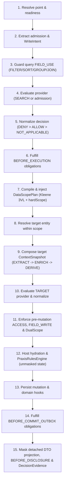
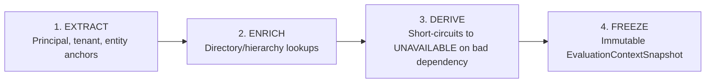

# Praxis Authz Enforcement Core

[](https://central.sonatype.com/artifact/io.github.codexrodrigues/praxis-authz-enforcement-core)

[](LICENSE)

Deterministic **15-step Policy Enforcement Point (PEP)** runtime for the **Praxis Authorization Decision Platform**, built strictly over [`praxis-authz-contracts`](https://github.com/codexrodrigues/praxis-authz-contracts) and Jackson without Spring Boot or Hibernate ORM runtime dependencies.

**Quick Links:**
[Maven Central](https://central.sonatype.com/artifact/io.github.codexrodrigues/praxis-authz-enforcement-core) ·
[Changelog](CHANGELOG.md) ·
[Releasing](RELEASING.md) ·
[Contributing](CONTRIBUTING.md) ·
[Security Policy](SECURITY.md) ·
[Contracts](https://github.com/codexrodrigues/praxis-authz-contracts) ·
[OPA Provider](https://github.com/codexrodrigues/praxis-authz-opa) ·
[Spring Boot Starter](https://github.com/codexrodrigues/praxis-authz-starter)

---

## Praxis Decision Platform & Architectural Thesis

The **Praxis Platform** is a **semantically oriented platform for AI-native enterprise applications**, in which **resources, rules, actions, data, and policies are described once** and operated uniformly by **traditional UIs, generative UIs, AI agents, and integrations** — building applications that are legible and operable by AI by design rather than bolting AI onto the side.

Within the Praxis Decision Platform, `decisionKind = BUSINESS` and `decisionKind = AUTHORIZATION` are strictly orthogonal planes:

| Plane | Canonical Owner | Responsibilities |
| :--- | :--- | :--- |
| **Resource & Domain Semantics** | [`praxis-metadata-starter`](https://github.com/codexrodrigues/praxis-metadata-starter) | `@ApiResource`, `x-ui`, `/schemas/filtered`, `/schemas/domain`, `@DomainGovernance`, `@DomainLineage`, `@Filterable`, `@WorkflowAction`, `@UiSurface`, stats, and export |
| **Control Plane & Governed Decisions** | [`praxis-config-starter`](https://github.com/codexrodrigues/praxis-config-starter) / [`praxis-config-contracts`](https://github.com/codexrodrigues/praxis-config-contracts) | UI config, AI registry, API catalog grounding, maker-checker approvals, and snapshot head lifecycle (`/api/praxis/config/**`) |
| **`decisionKind = BUSINESS`** | [`praxis-rules-engine`](https://github.com/codexrodrigues/praxis-rules-engine) | Deterministic 5-state domain invariants, eligibility, and calculations evaluated during server hydration/validation (**Step 12**) |
| **`decisionKind = AUTHORIZATION`** | [`contracts`](https://github.com/codexrodrigues/praxis-authz-contracts) -> **`praxis-authz-enforcement-core`** -> [`opa`](https://github.com/codexrodrigues/praxis-authz-opa) -> [`starter`](https://github.com/codexrodrigues/praxis-authz-starter) | Deterministic 15-step PEP runtime (`STEP_01..STEP_11` before rules; `STEP_13..STEP_15` post-hydration/disclosure) |

**Module Boundary Guarantee:** `maven-enforcer-plugin` bans `org.springframework.boot:*` and `org.hibernate.orm:*` from the transitive runtime dependency tree. All OPA transport concerns remain behind `AuthorizationProviderPort`, and JPA entity persistence remains isolated in host adapters.

---

## The 15-Step Enforcement Pipeline (`EnforcementPipelineExecutor`)



Notice the critical invariant between **Step 11**, **Step 12**, and **Step 15**:
- **Pre-hydration protection (`STEP_02` + `STEP_11`):** caller mutations are extracted directly from the wire payload (`WriteIntent`) and checked before server `hydrate*` or `PraxisRulesEngine` execution;
- **Unmasked internal state (`STEP_12`):** business rules always read true unmasked entity values (`P40`);
- **Detached post-read masking (`STEP_15`):** `DetachedDtoMaskingProcessor` projects and masks a cloned detached map/DTO projection — managed JPA entities are **never** mutated in place, preventing Hibernate dirty-checking from writing masked placeholders back to the database.

---

## Subsystems & Package Map

| Package | Key Components | Security & Correctness Guarantees |
| :--- | :--- | :--- |
| `...enforcement.context` | `UntrustedRequestHeaderGuard`, `ContextCompositionCoordinator`, `TrustedFactSource`, `ScopedExecutionContextHolder` | Blocks client authority spoofing (`x-authz-*`, `x-praxis-authz-*`, `x-bypass-*`, `x-workflow-*`); runs 4-stage `EXTRACT -> ENRICH -> DERIVE -> FREEZE`; guarantees `ThreadLocal` cleanup via `try-with-resources` |
| `...enforcement.writeintent` | `DtoWriteIntentExtractor`, `FieldWriteAuthorizer`, `FieldWriteViolationException` | Preserves `0`/`false`/`""` as `SET`, explicit JSON `null` as `CLEAR_EXPLICIT_NULL`, omitted `PATCH` keys as untouched, fails closed on unmapped wire keys (`AUTHZ_UNMAPPED_WRITE_WIRE_PATH`), and enforces `DualScopeDelegationSpec` (`OLD -> NEW` transfers require custody on both scopes) |
| `...enforcement.fielduse` | `FieldUseQueryGuard`, `FieldUseViolationException` | Blocks side-channel inference via restricted `FILTER`, `SORT`, `GROUP`, `AGGREGATE`, or `JOIN` fields (`P13`, `P50`) |
| `...enforcement.jpa` | `JpaDataScopeAdapter`, `QueryAdapterFieldBinding`, `CompiledDataScopeCriterion`, `RelationTraversalStrategy` | Pushes negation down to Negation Normal Form via De Morgan's laws, uses correlated `EXISTS`/`NOT EXISTS` subqueries for `1:N`/optional paths, escapes `LIKE ... ESCAPE '\'`, applies `LOWER(col)` on case-insensitive comparisons, and always joins host `hardScope` via `AND` (`DataScopeOutcome.ALL` never drops `hardScope`) |
| `...enforcement.masking` | `DetachedDtoMaskingProcessor`, `DetachedDtoMaskingResult`, `DtoFieldSchemaMetadata`, `MaskingConflictException` | Executes commutative masking over nested DTO/map graphs (`OMIT`, `NULLIFY`, `REDACT_CONSTANT`, `HASH_TOKEN_KEYED`, `SUMMARY_ONLY`, `CPF_CNPJ_PARTIAL`, `PARTIAL_MASK`), ensuring `FIELD_USE(VALUE)=DENY` dominates any mask |
| `...enforcement.obligation` | `ObligationBarrierCoordinator`, `TransactionalAuditOutboxPort`, `InMemoryTransactionalAuditOutbox` | Enforces fail-closed revocation of `PERMIT` if any obligation (`REQUIRE_MFA`, `REQUIRE_JUSTIFICATION`, `DURABLE_AUDIT_EVIDENCE`, `WATERMARK`) fails or conflicts at its barrier |
| `...enforcement.pipeline` | `EnforcementPipelineExecutor`, `HostDecisionNormalizationEngine`, `NormalizedEnforcementOutcome`, `AuthorizationProviderPort` | Coordinates `executeTargetPipeline(...)` and `executeSearchPipeline(...)`, enforces readiness gates (`PointAuthorityMode.AUTHORITATIVE`), and produces sanitized `DecisionEvidence` |

### 4-Stage Context Resolution (`ContextCompositionCoordinator`)



---

## Maven Central Coordinates

Requires **Java 21**. Runtime dependencies are strictly `praxis-authz-contracts` and Jackson `2.18.2`:

```xml
<dependency>
    <groupId>io.github.codexrodrigues</groupId>
    <artifactId>praxis-authz-enforcement-core</artifactId>
    <version>0.1.0-beta.1</version>
</dependency>
```

---

## Usage Examples

### 1. Pre-Hydration WriteIntent Extraction (`DtoWriteIntentExtractor`)

```java
import org.praxisplatform.authz.contracts.binding.BatchAuthorizationMode;
import org.praxisplatform.authz.contracts.binding.TransactionCardinality;
import org.praxisplatform.authz.contracts.binding.WriteIntent;
import org.praxisplatform.authz.enforcement.writeintent.DtoWriteIntentExtractor;

DtoWriteIntentExtractor extractor = new DtoWriteIntentExtractor();

WriteIntent intent = extractor.extractFromJson(
        "UPDATE_PARTIAL",
        true, // partialPatch=true: omitted fields remain untouched
        BatchAuthorizationMode.NONE,
        TransactionCardinality.SINGLE_TARGET,
        "{\"salary\": 9500.00, \"managerNotes\": null}",
        Map.of(
                "/salary", "employee.salary",
                "/managerNotes", "employee.managerNotes"
        )
);
// Produces SET(/salary -> employee.salary) and CLEAR_EXPLICIT_NULL(/managerNotes -> employee.managerNotes)
```

### 2. Kleene 3VL JPQL Scope Compilation (`JpaDataScopeAdapter`)

```java
import org.praxisplatform.authz.contracts.datascope.DataScopePlan;
import org.praxisplatform.authz.enforcement.jpa.CompiledDataScopeCriterion;
import org.praxisplatform.authz.enforcement.jpa.JpaDataScopeAdapter;

JpaDataScopeAdapter scopeAdapter = new JpaDataScopeAdapter(projection, fieldBindings);

CompiledDataScopeCriterion criterion = scopeAdapter.compile(
        dataScopePlan,
        "e.tenantId = :__praxis_hard_tenant_id",
        Map.of("__praxis_hard_tenant_id", callerTenantId),
        rowFacts -> Objects.equals(callerTenantId, rowFacts.get("tenantId").value())
);
// criterion.composedWhereClause() composes "(hardScope) AND (NNF dataScope predicate)" safely
```

### 3. Detached DTO Masking (`DetachedDtoMaskingProcessor`)

```java
import org.praxisplatform.authz.enforcement.masking.DetachedDtoMaskingProcessor;
import org.praxisplatform.authz.enforcement.masking.DetachedDtoMaskingResult;

DetachedDtoMaskingProcessor processor = new DetachedDtoMaskingProcessor();

DetachedDtoMaskingResult result = processor.projectAndMask(
        responseDto,
        dtoFieldSchemas,
        valueDeniedAttributeIds,
        maskDirectives
);
// result.maskedProjection() contains the masked detached map; responseDto is untouched
```

---

## Build, Verification & Governance

Run the local verification suite with JDK 21 and Maven 3.9+:

```powershell
mvn -B clean verify
```

Related repository documentation:
- [CHANGELOG.md](CHANGELOG.md) — version history and published artifacts
- [RELEASING.md](RELEASING.md) — multi-repository release order and Maven Central publication flow
- [ACTIONS-RELEASE-POLICY.md](ACTIONS-RELEASE-POLICY.md) — GitHub Actions usage and release gate policy
- [CONTRIBUTING.md](CONTRIBUTING.md) — module boundaries, enforcer rules, and contribution workflow
- [SECURITY.md](SECURITY.md) — vulnerability disclosure and fail-closed security invariants
- [AGENTS.md](AGENTS.md) — coding and governance rules for autonomous agents

## License

Licensed under the [Apache License, Version 2.0](LICENSE).
